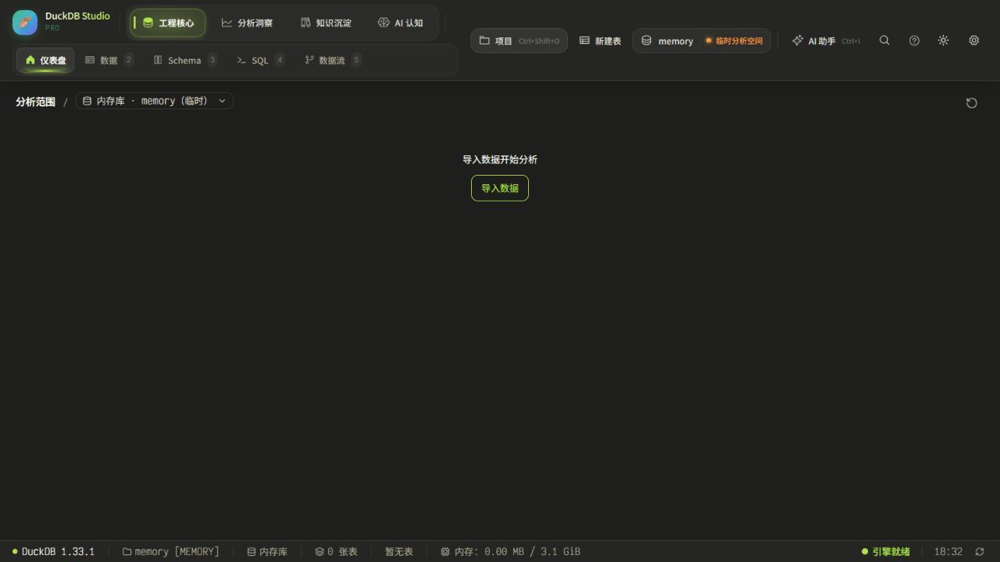
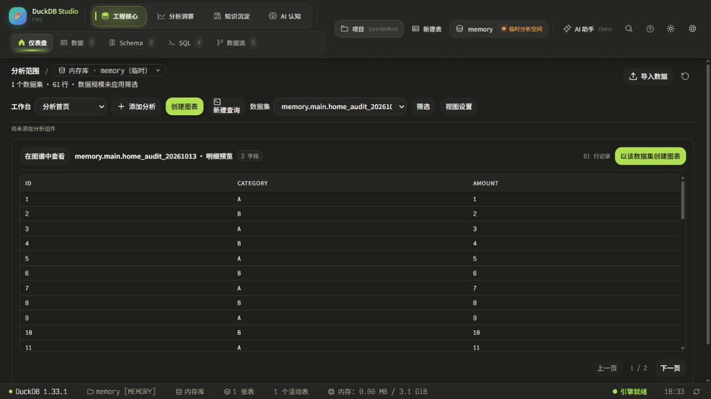
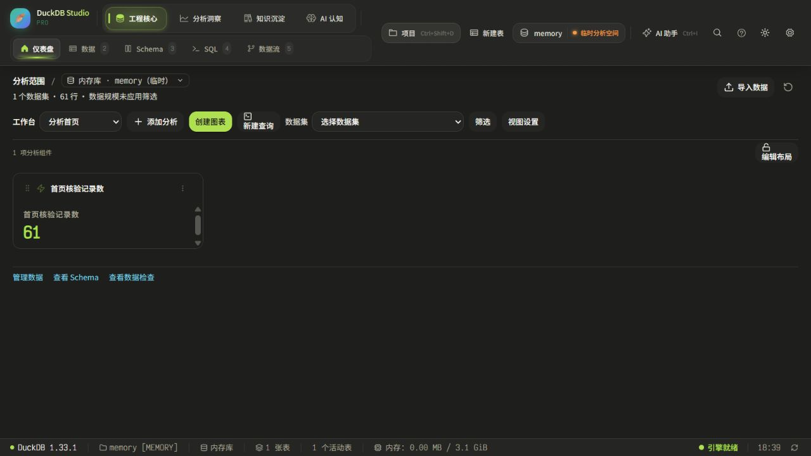
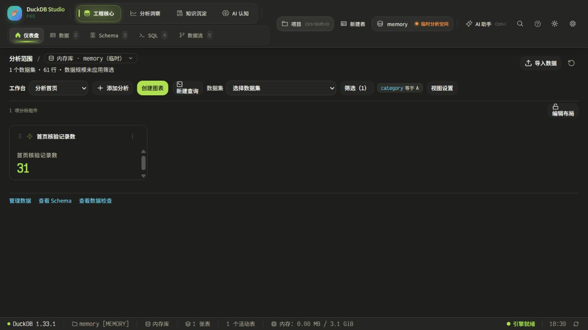
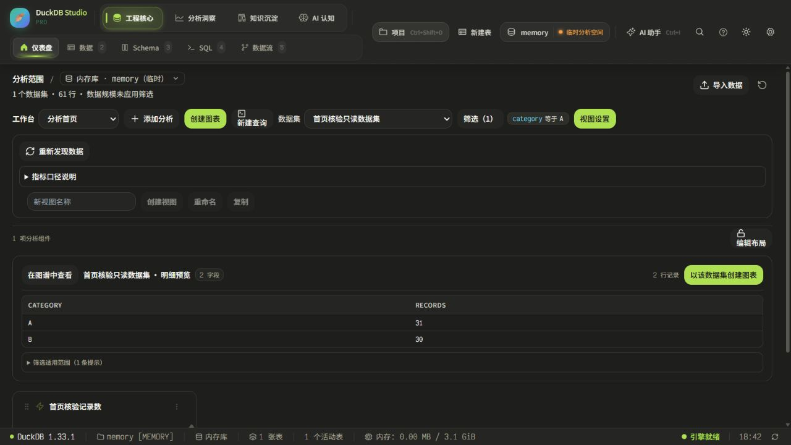

# 首页功能扫描与修复报告

日期：2026-10-13（America/Los_Angeles）。业务背景：无。上限：3 轮；实际：2 轮。以本次工作开始时的未提交文件为基线；没有提交或推送。

结论：已修复 3 项一级缺陷；2 项待确认未修改。第二轮在相同范围内没有新增已证实的一级缺陷，按停止条件结束。没有宣称整个系统、所有数据组合或所有权限状态均通过。

## 覆盖与依据

- 范围内页面总数 1，已扫描 1；直接子视图 11，已扫描 11；相关组件 16。
- 本地服务接口清单 33，相关调用路径已静态核对 33；范围内 HTTP 业务接口 0。运行验证采用下文的具体流程和 140 项相关测试，不把静态接口核对等同于全接口运行验收。
- 详细清单见 [system-map.md](system-map.md) 和 [inventory.json](inventory.json)。未扫描的目标模块和原因在系统地图边界段列明。
- 依据仅用当前源文件、现有测试约定和本次界面/引擎执行结果。旧审查报告和旧截图未作为通过证据。
- 所有修复均为缺陷、一级；没有自动实现业务推导项，没有权限、存储结构、公共接口契约或业务计算规则变更。

## 八维扫描结果

| 维度 | 本次范围的实际检查 | 结果与限制 |
|---|---|---|
| 1 失效入口 | 导入、图表、内容库、组合数据集、视图复制/切换、筛选、全屏、CSV、刷新、布局锁定；路由接线 | H02 刷新遗漏已修；目标页面内部不在验收范围 |
| 2 未完成/占位 | 当前挂载组件、SQL来源、查询执行、加载与错误文案 | 实际数据来自 DuckDB；未以 Input placeholder、空态或未挂载旧组件判定功能缺口 |
| 3 流程完整性 | 预览分页 → 图表配置 → 加入首页 → 筛选 → 明细 → 导出；视图复制与返回 | 运行流程成立；未凭新增功能反推删除等需求，见 C02 |
| 4 数据断链 | 列元数据、查询与数据集身份、看板快照更新、视图关联 | H01/H02 已修；显式绑定的筛选适用范围提示保留 |
| 5 状态缺失 | 空库、异步加载、数据/对象读取失败、重试、保存禁用、组件错误恢复 | 140 项测试覆盖其中相关状态；刷新成功提示语义见 C01；没有账号/权限规则证据，不声称权限分支通过 |
| 6 输入处理 | 空名称禁用、数字/日期/布尔筛选校验、只读SQL、字段映射、关联键 | H03 复用既有验证已修；重复提交、保存失败和请求乱序在相关测试中回归；未做穷举长文本/全部输入组合 |
| 7 接口一致性 | 上述 33 个本地接口的调用参数、返回值及现有数据对象 | 未发现需要自动改契约的已证实项；没有创建新接口 |
| 8 同类能力 | 明细预览与图表/组合数据集执行约束、刷新路径、保存及错误模式 | H03 同一校验能力复用；纯视觉问题仅转UI审查 |

## 已修复项

### H01 · 较旧的看板响应覆盖最新快照

- 位置：[hooks/useDashboardWorkflow.ts:600](C:/Users/luoyu/Desktop/Duckdb_Manager/duckdb-editor/hooks/useDashboardWorkflow.ts:600)。
- 现象：同一数据库连续触发看板更新，较晚返回的旧快照可覆盖已显示的新名称或配置。
- 证据：[docs/home-functional-audit-20261013-current/before/hooks/useDashboardWorkflow.ts.txt:600](C:/Users/luoyu/Desktop/Duckdb_Manager/duckdb-editor/docs/home-functional-audit-20261013-current/before/hooks/useDashboardWorkflow.ts.txt:600)；复现用例 [components/Dashboard.test.tsx:164](C:/Users/luoyu/Desktop/Duckdb_Manager/duckdb-editor/components/Dashboard.test.tsx:164)；[修复前日志](round1-red.txt)。
- 根因：reloadHomeBoardOnly 只核对数据库，没有核对请求先后或生命周期。
- 修改内容：增加请求代次；只接纳最新请求的结果，卸载或重建监听时使旧请求失效。持久化数据与接口签名不变。
- 修改前后及回退依据：[H01.diff](H01.diff)、[H01-test.diff](H01-test.diff) 和 before/ 中原文件快照；逐文件哈希见 [changes.json](changes.json)。回退仅逆向本项差异，不覆盖其他未提交工作。
- 验证方法：控制两次真实组件请求的返回顺序：新响应先返回、旧响应后返回；断言最新名称保留。
- 验证结果：修复前实际得到「过期视图」，修复后保留「最新视图」。 [修复后定向测试](round1-green.txt)：23/23；[相关回归](regression.txt)：140/140。这包含组件运行测试与真实数据库基线读取；受控乱序/失败为测试注入，未冒充真实线上故障。

### H02 · 顶部刷新漏读数据集列表

- 位置：[components/Dashboard/Home/HomeBoardCanvas.tsx:90](C:/Users/luoyu/Desktop/Duckdb_Manager/duckdb-editor/components/Dashboard/Home/HomeBoardCanvas.tsx:90)。
- 现象：顶部刷新会更新统计与组件查询，但数据集列表及字段元数据不随 refreshTrigger 重新读取。
- 证据：[docs/home-functional-audit-20261013-current/before/components/Dashboard/Home/HomeBoardCanvas.tsx.txt:90](C:/Users/luoyu/Desktop/Duckdb_Manager/duckdb-editor/docs/home-functional-audit-20261013-current/before/components/Dashboard/Home/HomeBoardCanvas.tsx.txt:90)；复现用例 [components/Dashboard/Home/HomeBoardCanvas.audit.test.tsx:22](C:/Users/luoyu/Desktop/Duckdb_Manager/duckdb-editor/components/Dashboard/Home/HomeBoardCanvas.audit.test.tsx:22)；[修复前日志](round1-red.txt)。
- 根因：数据集加载 effect 未监听已有的 refreshTrigger。
- 修改内容：把已有 refreshTrigger 加入依赖；继续沿用 refreshDatasets 的请求代次、失败提示、重试和选择恢复逻辑。
- 修改前后及回退依据：[H02.diff](H02.diff)、[H02-test.diff](H02-test.diff) 和 before/ 中原文件快照；逐文件哈希见 [changes.json](changes.json)。回退仅逆向本项差异，不覆盖其他未提交工作。
- 验证方法：第一次列表仅含 orders；改变加载结果并触发首页刷新，断言新来源出现且原选择不丢失。另在浏览器执行顶部刷新。
- 验证结果：修复前无法找到新增来源；修复后新增来源可选，原选择保留。浏览器刷新后组件仍为 31、两个数据集可选。 [修复后定向测试](round1-green.txt)：23/23；[相关回归](regression.txt)：140/140。这包含组件运行测试与真实数据库基线读取；受控乱序/失败为测试注入，未冒充真实线上故障。

### H03 · 明细预览漏用已有的关联键校验

- 位置：[components/Dashboard/Home/DatasetPreview.tsx:33](C:/Users/luoyu/Desktop/Duckdb_Manager/duckdb-editor/components/Dashboard/Home/DatasetPreview.tsx:33)。
- 现象：组合数据集保存和图表执行会复核右侧唯一键，首页明细预览却直接查询，可能显示不满足已保存约束的结果。
- 证据：[docs/home-functional-audit-20261013-current/before/components/Dashboard/Home/DatasetPreview.tsx.txt:31](C:/Users/luoyu/Desktop/Duckdb_Manager/duckdb-editor/docs/home-functional-audit-20261013-current/before/components/Dashboard/Home/DatasetPreview.tsx.txt:31)；复现用例 [components/Dashboard/Home/DatasetPreview.requests.test.tsx:22](C:/Users/luoyu/Desktop/Duckdb_Manager/duckdb-editor/components/Dashboard/Home/DatasetPreview.requests.test.tsx:22)；[修复前日志](round1-red.txt)。 同类已有实现：[services/workbench/runtime.ts:56](C:/Users/luoyu/Desktop/Duckdb_Manager/duckdb-editor/services/workbench/runtime.ts:56)，既有规则：[services/workbench/datasetGuards.ts:6](C:/Users/luoyu/Desktop/Duckdb_Manager/duckdb-editor/services/workbench/datasetGuards.ts:6)。
- 根因：DatasetPreview 未复用已有 validateUniqueKeys；其余同类执行路径已有这一检查。
- 修改内容：查询前调用同一 validateUniqueKeys，并在异步校验后检查请求仍有效；复用既有错误与重试界面。未新增规则、改 SQL 或计算口径。
- 修改前后及回退依据：[H03.diff](H03.diff)、[H03-test.diff](H03-test.diff) 和 before/ 中原文件快照；逐文件哈希见 [changes.json](changes.json)。回退仅逆向本项差异，不覆盖其他未提交工作。
- 验证方法：用受控返回使已有校验发现重复键，断言出现原有错误且不执行明细查询；重试恢复后显示从真实 baseline.duckdb 读取的数据。
- 验证结果：修复前没有错误并继续读取；修复后阻止无效预览、显示原因，重试后恢复。普通数据集的浏览器预览与分页正常。 [修复后定向测试](round1-green.txt)：23/23；[相关回归](regression.txt)：140/140。这包含组件运行测试与真实数据库基线读取；受控乱序/失败为测试注入，未冒充真实线上故障。

## 待确认项（未自动修改）

### C01 · 刷新完成与部分失败的结果语义（无法确认／按二级处理）

- 位置/证据：[hooks/useDashboardWorkflow.ts:1132](C:/Users/luoyu/Desktop/Duckdb_Manager/duckdb-editor/hooks/useDashboardWorkflow.ts:1132) 顺序等待后显示成功；[hooks/useDashboardWorkflow.ts:612](C:/Users/luoyu/Desktop/Duckdb_Manager/duckdb-editor/hooks/useDashboardWorkflow.ts:612) 与 [hooks/useDashboardWorkflow.ts:424](C:/Users/luoyu/Desktop/Duckdb_Manager/duckdb-editor/hooks/useDashboardWorkflow.ts:424) 各自在内部捕获失败并设置错误状态。
- 现象：从代码可证，部分读取失败可转为页面错误状态，而外层仍可显示“仪表盘数据已刷新”。本次没有在浏览器制造持久化损坏，不能把该失败组合标记为已运行复现。
- 建议处理方式：确认完成语义后，统一内部刷新结果约定和外层提示，再用部分失败注入验证；本次不自行更改接口返回约定。
- 需要确认：成功提示代表“刷新流程结束”，还是“全部子读取均成功”；部分失败时应显示哪种提示。缺少明确的结果契约/产品约定。

### C02 · 无物理记录时工作台可见性（正常业务差异；扩展需求待确认，按二级处理）

- 位置/证据：[components/Dashboard/MissionControl/DataIdeMissionControl.tsx:168](C:/Users/luoyu/Desktop/Duckdb_Manager/duckdb-editor/components/Dashboard/MissionControl/DataIdeMissionControl.tsx:168)；[components/Dashboard/MissionControl/DataIdeMissionControl.test.tsx:101](C:/Users/luoyu/Desktop/Duckdb_Manager/duckdb-editor/components/Dashboard/MissionControl/DataIdeMissionControl.test.tsx:101) 明确约定无数据时隐藏已有看板；[services/workbench/datasets.ts:50](C:/Users/luoyu/Desktop/Duckdb_Manager/duckdb-editor/services/workbench/datasets.ts:50) 支持只读查询定义。
- 现象：空库或仅零行表使用导入空态，已有工作台不展示。它有明确现有测试依据，因此没有当作缺陷修复；是否应让用户在这种状态访问已保存定义，系统证据不足。
- 建议处理方式：保留现有行为；如要支持无记录工作台，再明确可见性、来源失效及空态约定。
- 需要确认：是否需要支持只有零行表或只读查询定义的首页工作台。没有业务背景，不能自行推导新功能。

推导项：0。上述 2 项均没有自动修改。

## 运行验证步骤与健康情况

1. 空库首页与导入入口：正常。01-empty.jpg 现场截图；未加载系统示例/Mock替换产品数据。
2. 粘贴导入 61 行明确命名的验证数据，返回首页：正常；引擎预览 50 行/页，第二页 11 行，边界按钮禁用正确。02-home-populated.jpg。
3. 从该数据集创建记录数指标卡并加入首页：正常；真实 SQL COUNT 为 61。03-chart-saved.jpg。
4. 统一条件 category=A：正常；指标卡为 31；全屏明细 value=31，实际导出 CSV 为 `"value"
"31"`。04-filtered-31.jpg。
5. 复制工作台为“首页核验副本”再选择“分析首页”：正常；组件、筛选及结果保留。
6. 创建只读 SQL 数据集，预览得到 A=31、B=30：正常。该数据集未显式绑定原全局筛选，显示筛选适用范围提示，是现有绑定规则，并非断链。05-custom-dataset.jpg。
7. 打开组件实例设置、字段/单位配置后取消：入口正常；未借此改动定义。保存失败处理由相关回归用例验证。
8. 顶部刷新、布局解锁再锁定、分析范围菜单：正常；刷新后仍为 31，数据集定义仍可选；未切入用户的其他持久库测试。

图表创建过程中出现一次开发热更新的 Hook 顺序错误：发生于本次增加 useRef 后的 Fast Refresh，使用页面现有 Retry 重新挂载即恢复，数据仍在；后续稳定运行和构建通过。未把开发热更新恢复冒充产品缺陷修复。曾有一次截图采到已退出的弹窗，03-chart-preview.jpg 未作为图表预览证据采用，替换为明确已保存结果 03-chart-saved.jpg。

当前验证数据在新建浏览器会话的 memory 临时库；没有覆写用户业务表。生成了 home_audit_20261013、一个测试指标组件、一份测试视图副本和一个测试只读数据集；按“不得自动删数据”的约束保留。导出文件在本机下载目录。没有往远程平台发布。

## 回归与自我核查

- 第 1 轮：系统地图/八维代码扫描与空库、导入、预览运行检查；3 个新增用例先失败，再最小修复；23 项定向测试通过。已修复不足 5 项，随机排序后全查 3 项；源证据、基线快照、差异、断言和日志匹配。
- 第 2 轮：复查八维与修复相关路径；完成上述图表、筛选、导出、视图、数据集、布局运行流程；相关 29 个测试文件、140 项测试通过；没有新增已证实的一级项；复核全部 3 项后结束，未用满 3 轮。
- 随机核查顺序及结果：[self-check.json](self-check.json)。无错配，不需要扩大重核。正常空库差异没有误判；推测没有写成已证实缺陷；二级内容未修改；范围内 1 页面/11子视图有扫描记录，范围外不标通过。
- 类型检查通过：[typecheck.txt](typecheck.txt)（无错误输出）；构建通过：[build.txt](build.txt)。构建有既有大包体积提示，本次没有进行无关优化。
- 定向差异空白检查通过。测试不是全仓库验收：没有运行其他业务模块的全部测试，也没有声称其无退化。
- 样式文件、布局算法、业务 SQL 编译规则、数据结构及权限逻辑均未修改；修改范围为 3 个生产文件和 3 个回归测试文件。

## 转 UI 审查

- UI01：03-chart-saved.jpg / 04-filtered-31.jpg 的 KPI 卡片内部可见短滚动区域；结果可读、操作可用，属于视觉/空间问题，未调整 CSS、卡片尺寸或重新设计。
- 可访问性：观察了对话框名称、输入标签、禁用状态、状态/错误区域及菜单入口；不以截图或本次测试宣称完整 WCAG、屏幕阅读器或所有键盘流程通过。

## 现场截图

