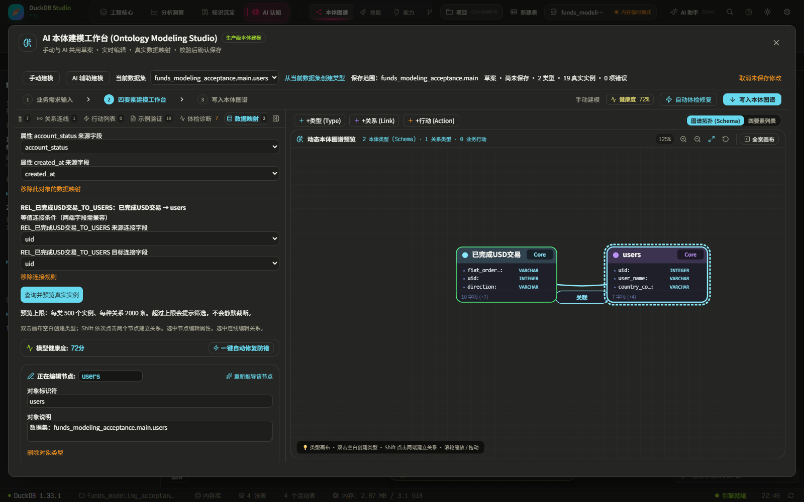
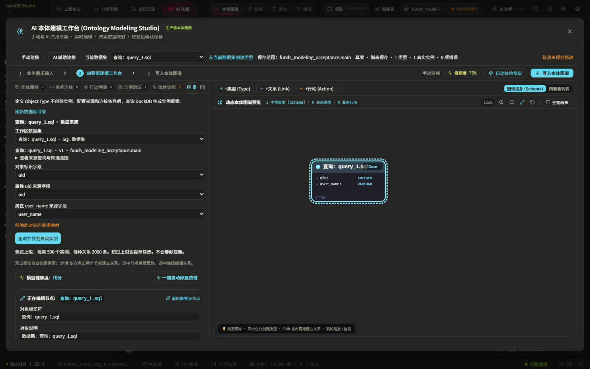

# 本体建模与当前工作区数据集联通验收

日期：2026-10-12（用户时区）。本记录补充此前单组件验收，重点检查现有数据集、跨页面选择、查询结果、本体保存和主图之间的真实链路。

## 改动后的操作

1. 在首页选择已有数据集，或在数据/SQL 工作台选择当前来源。
2. 进入 AI 认知 → 本体建模，顶部直接显示共享的当前数据集和保存范围。
3. 点击「从当前数据集创建类型」，从真实字段元信息生成属性定义；选择唯一标识字段，再按需连接另一个数据集。
4. 「数据映射」中既可选择现有工作区数据集，也可沿用物理表映射。SQL 数据集保留来源查询，包括首页已经应用的筛选。
5. 对尚未注册的当前 SQL 查询，入口明确显示「保存当前查询为数据集并创建类型」，复用原 `saveQueryDataset` 注册稳定身份，再进入同一个本体草案。
6. 查询并预览真实实例，通过校验并确认后保存。关闭工作台后显示正式本体主图，元数据刷新不会把它自动切回其他数据切片。
7. 来源数据更新后，重新打开已保存本体，在数据映射中重新查询、预览并确认。正式实例保留确认机制，不会因一次来源变动而被静默覆盖。

## 联通点

- 复用共享 `useAppStore.activeDataset/currentTable/currentDatabase`，以及首页已有的 `loadDatasets` / `DatasetDefinition` / `saveQueryDataset`，没有新增一套独立的数据集目录。
- `useOntologyDatasets` 读取当前数据库、Schema、已有表和 SQL 数据集；首页也能恢复共享的已选数据集。
- 本体映射在原规范化结构中保存数据集 ID、所属工作区、版本、定义 SQL 和实际执行 SQL。后者保留当时应用的筛选，实例来源可追溯。
- 预览和保存前重新解析目录，拒绝已删除、变更版本、不可用或丢失映射字段的数据集。保存事务内再检查实际来源输出字段。
- 本体草案固定保存范围，切换数据库或 Schema 后禁止写到错误位置。草案保留，返回原范围后可继续处理。
- 数据库切换刷新本体 Store；过期读取结果不回写当前图谱。延迟布局任务在切库时取消，已经排队的坐标写入明确限定原数据库和 Schema。
- 数据集定义修改发送共享刷新事件，首页、建模和现有分析运行链路使用相同通知。

## 实测来源与结果

使用项目已有 `data/crud-lab/baseline.duckdb`，没有生成替代业务记录。通过应用原数据库导入入口读取，并从该文件四张表创建隔离验收副本 `funds_modeling_acceptance`。原始文件 SHA256 在执行前后均为：

`a16db823884ef4c8a6056214c624eaf12fc12a454e31a93f2ab180b5948cc887`

| 跨模块场景 | 最终结果 |
| --- | --- |
| 首页选中法币交易，再打开建模 | 自动带入同一数据集身份；来源 25 行 |
| 使用首页已有 SQL 数据集创建入口 | 建立“已完成 USD 交易”；真实查询返回 9 行 |
| SQL 数据集 + 用户数据集建模 | 9 笔交易、10 个用户，按 `uid = uid` 关联，生成 19 个真实实例、9 条实例关系 |
| 来源值核对 | 所有交易属性逐行与 DuckDB 来源结果一致；BIGINT、DECIMAL、时间字段均覆盖 |
| 保存后主图 | 2 个类型、19 个实例、1 条类型关系、9 条实例关系；实际界面回到正式图谱 |
| 来源数据修改 | 只在验收副本中将一笔金额从 50000 改为 50001；确认前正式值保留，重新查询并确认后值更新，实例数与关系数不增加 |
| 切换数据库后保存旧草案 | 被阻止；`memory` 中没有创建错误的本体实例表 |
| 修改已保存 SQL 数据集定义 | 旧绑定预览及保存均被阻止，正式 19 个实例保留 |
| SQL 编辑器执行查询，再导航建模 | 直接复用已执行查询；显式注册为数据集后得到 1 个 US 用户实例；取消草案后正式实例仍为 19 个 |
| 最后一轮浏览器日志 | 未记录控制台 ERROR；切库后后台布局缺表错误没有再出现 |

主图还会展示真实属性叶节点，所以 SVG 总节点数大于 19；上表的实例数按原图谱 `instance` 类型统计。

## 自动验证

- 定向回归：26 个文件、195 项测试通过。包含建模、数据集、查询编译、分析运行、真实资金基线、首页、数据库持久化、本体 Store、当前图谱来源和 D3 相关测试。
- 类型检查：通过。
- 生产构建：通过，39.56 秒。原有依赖 eval、混合导入和大包提示仍存在。
- 修改文件空白检查：通过；工作区其他已有改动保留。

证据：[回归结果](ontology-current-dataset-20261012/regression.txt)、[类型检查](ontology-current-dataset-20261012/typecheck.txt)、[构建](ontology-current-dataset-20261012/build.txt)、[真实来源导入](ontology-current-dataset-20261012/setup.txt)、[跨页面建模](ontology-current-dataset-20261012/flow.txt)、[更新与切库保护](ontology-current-dataset-20261012/refresh.txt)、[当前 SQL 查询](ontology-current-dataset-20261012/current-sql.txt)。

## 真实回放发现的缺口及修复

1. 此前只列物理表，缺少已有 SQL 数据集与当前选择：接入共享数据集定义和执行查询，不再要求重新录入同一来源。
2. 相同表名的数据库切换后，首页可能仍保留旧元信息而持续显示加载：元信息读取显式依赖当前数据库，并忽略旧范围结果。
3. DuckDB WASM 的时间字段实际是毫秒数，原字符串校验导致真实资金实例失败：校验支持真实返回表示，保留来源值，不伪造日期。
4. 保存产生的元数据通知会再次激活当前数据切片：只有数据来源本身变化才切换模式，正式保存后的图谱不会被目录刷新遮住。
5. 延迟画布坐标写入可能落到切换后的数据库：取消过期任务、检查上下文版本，并对写入明确限定原库和 Schema。

## 验证边界

验证使用原资金数据的隔离副本，没有改写用户正在使用的生产库，也没有直接操控用户原浏览器会话。当前工作区接入路径已经实现并做跨页面实际操作；在线 AI 服务、生产库权限差异和跨浏览器重启持久化没有在这一轮重新认证。

重放顺序：Playwright CLI 独立会话中依次运行 `verify-modeling-dataset-setup.js`、`verify-modeling-dataset-flow.js`、`verify-modeling-dataset-refresh.js`；进入 SQL 页后运行 `verify-modeling-current-sql.js`。脚本均位于 `scripts`，只应用于隔离验收环境。

