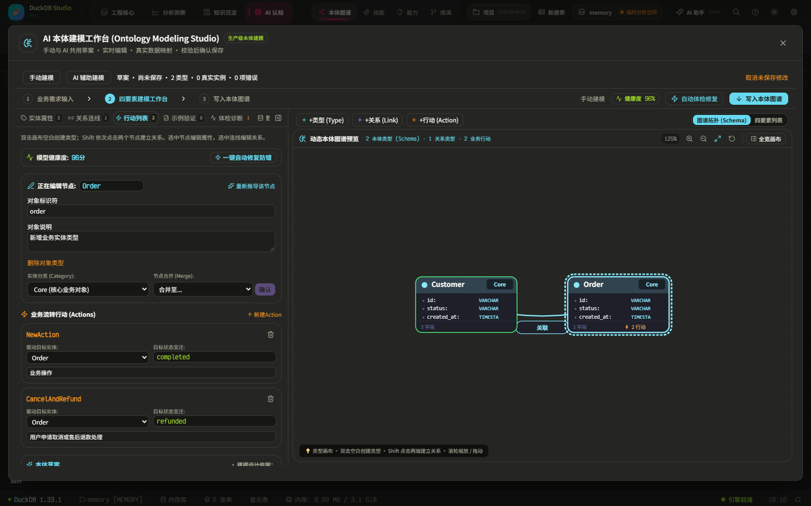
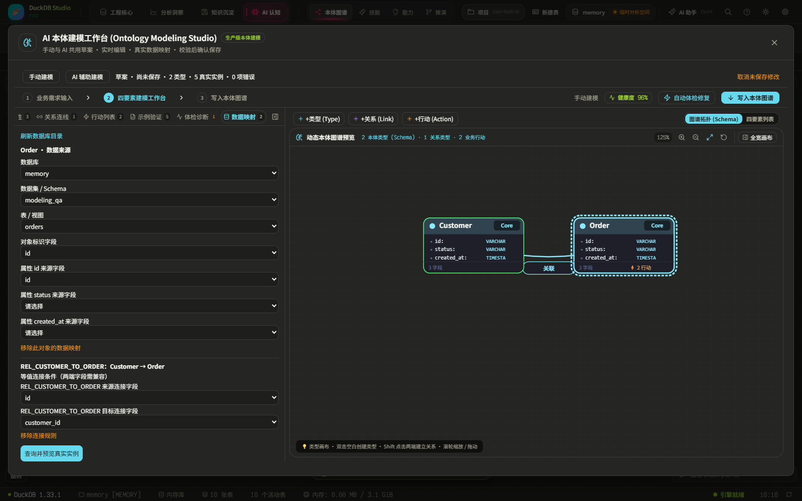

# 本体建模改造验收记录

后续已补做现有工作区数据集、首页和 SQL 查询的联通改造及真实资金数据验收，见[当前数据集联通记录](ontology-current-dataset-acceptance-20261012.md)。本文件保留第一阶段的范围与证据。

日期：2026-10-12。范围：AI 认知 → 知识图谱 → 本体建模。

按 [loop-engineering-meta](https://github.com/lovemoganna/Org-Skills/blob/main/skills/loop-engineering-meta/SKILL.md) 执行现状检查、基线、最小实现、实际回放、故障修复和回归。未提交或推送；保留工作区原有修改。

## 已实现

- 在原工作台增加手动入口、空白类型创建、属性编辑、关系连接和 Action 编辑。左侧编辑、右侧画布；名称、说明、标识、约束、连接实时同步。画布空白双击建类型，按 Shift 依次点击两类型建立关系。
- 手动与 AI 复用 `OntologyModelingResult`、原有校验器、画布及 `batchImportModelingResult`。AI 建议逐项接受或拒绝，接受后仍属于草案；模式切换保留草案，未确认建议阻止保存。
- AI 原有启发式生成结果中的示例实例不再被工作台当作真实业务数据保存。类型定义和实例分别管理；类型关系在原 D3 主图中也能显示。
- 草案统一校验，定位元素并给出修正提示。覆盖重名、标识冲突、无效端点、悬空引用、字段类型、必要属性和映射过期。失败阻止正式写入；退出未保存草案需明确放弃。
- 删除类型前展示关联类型、关系、实例、Action 及外部引用。内部引用随确认级联删除；真实画布、反思和洞察引用未解除时禁止删除。自动布局坐标随实例删除清理。
- 通过 DuckDB 数据库、Schema、表/视图、字段选择配置标识和属性来源，以及明确的关系等值连接条件。实例和边来自真实 SELECT/JOIN 查询，保留来源信息。
- 正式写入使用现有事务队列的事务内查询器，避免递归排队死锁；校验、并发版本检查、删除引用检查及保存均受事务保护。原 Action 执行状态和日期在编辑后保留。

## 复用与持久化

复用 `ontologyModelingService`、`OntologyModelingWizard`、`useOntologyStore`、`duckDBService`、`D3GraphView` 和原 `ONTOLOGY_CREATE_STATEMENTS`。

正式实例仍写原有五张本体表。原表不能完整表达属性定义、类型端点、数据映射和类型 Action，因此增加 `${objectTypeTable}__modeling_schema` 扩展表，存放同一规范化模型的定义信息，和原表在同一事务保存。没有建立另一套手动模型。载入时结合正式行和扩展元信息恢复可编辑草案。

## 验证结果

| 验证 | 结果 | 证据 |
| --- | --- | --- |
| 改造前基线 | 4 文件、27 测试通过 | 初始定向执行记录；覆盖原工作台、服务、布局和导出 |
| 自动回归 | 25 文件、187 测试通过 | [regression.txt](ontology-modeling-20261012/regression.txt) |
| 最新保护边界回归 | 3 文件、15 测试通过；与上一组有重叠 | [guards.txt](ontology-modeling-20261012/guards.txt) |
| 类型检查 | 通过 | [typecheck.txt](ontology-modeling-20261012/typecheck.txt) |
| 生产构建 | 通过，3 分 1 秒 | [build.txt](ontology-modeling-20261012/build.txt) |
| 真实浏览器手动流程 | 通过：类型、连接、Action、AI 建议、切换、保存重载、删除影响、冲突拦截和放弃修改 | [manual-ui.txt](ontology-modeling-20261012/manual-ui.txt) |
| 真实 DuckDB 数据流程 | 通过：5 条 SQL 来源记录生成 5 实例、3 关系；来源重载、幂等重查、过期映射和重复标识拦截 | [real-data.txt](ontology-modeling-20261012/real-data.txt) |
| 事务与引用 | 通过：最后写入故障注入完整回滚、并发修改拦截、外部画布引用阻止删除、动作状态保留及类型目标转换 | 同上 |
| 原主图投影 | 通过：2 类型、5 实例、1 类型关系、3 实例关系 | [graph.txt](ontology-modeling-20261012/graph.txt) |

自动回归覆盖原本体工作台、AI 服务、CRUD、主面板、D3 图、OntologyCanvas、布局、路径/聚焦、导出及数据库持久化相关测试。不是整个仓库的全量测试结果。jsdom 缺少 Canvas 渲染实现的提示没有导致测试失败；真实画布另外在浏览器操作并检查截图。构建仍有依赖 eval、混合导入和包体积提示。

实际数据测试在独立浏览器临时数据库执行 SQL 创建 `modeling_qa.customers`（2 行）和 `modeling_qa.orders`（3 行），连接条件 `customers.id = orders.customer_id`。这是实际 DuckDB 查询链路的验收用数据，不是用户生产数据，也没有前端 Mock 替代查询。保存重载测试指关闭、重新打开本体编辑器；临时内存数据库不承诺跨浏览器重启保留。

## 发现并修复的问题

1. 旧测试依赖 AI 自动修复绕过确认：更新为显式处理建议后才允许保存。
2. 新节点重叠、选中光圈动画改变点击边界、工作台画布高度不足：修正确定性位置、选择标记和容器高度；实际回放后确认。
3. 空白建模仅建核心表，主图布局保存缺表：复用既有画布与引用表定义，不导入示例业务实例。
4. 自动布局插入坐标引用被误判为本体并发冲突：版本检查只比较正式本体内容，业务引用在事务内另行检查；自动坐标和业务画布引用分开处理。
5. 删除映射类型导致其余未修改实例误报过期：仅在删除前映射有效时更新剩余实例签名，原本过期的映射仍报错。
6. 实例 Action 转成类型 Action 后遗留实例行，以及编辑重置执行状态：补齐删除和保留原状态的更新路径，并以实际 SQL 验证。
7. 查询完成覆盖查询期间的编辑：拒绝过期结果；编辑器卸载后也不写回草案，新增组件测试覆盖两种情况。

保留早期失败证据：[点击边界失败](modeling-ui-failed-pulse.txt)、[布局版本冲突回放](modeling-data-failed-layout-revision.txt)。回放脚本另修正了重复使用固定并发修改值、开发热更新后的模块缓存、浏览器卸载确认处理等测试问题；这些失败没有作为通过证据。

## 尚未验证与范围限制

- 在线 AI 供应商请求未实测；浏览器测试使用既有服务的离线启发式路径，原 AI 服务自动测试通过。
- 未连接用户生产库验收，未实测文件库的跨浏览器重启恢复。继承原数据库存储模式，临时内存库随会话结束而消失。
- 关系映射当前支持明确的两端等值连接。每类实例预览上限 500、每种关系上限 2000，超过直接报错，需先创建筛选视图；不会静默截断。
- 原布局、路径和导出能力通过定向自动回归；未逐项执行所有浏览器布局和下载格式组合。

因此，已执行的组件及真实查询回放全部通过；在线 AI、生产库和全部图谱交互组合仍列为未验证项，不宣称全部验收条件已完成生产环境认证。

## 重放

自动回归命令见证据文件首行。浏览器使用 Playwright CLI 的独立临时会话，在开发服务器上依次执行：

1. `scripts/verify-modeling-ui.js`
2. `scripts/verify-modeling-data.js`
3. `scripts/verify-modeling-graph.js`

三个脚本是 CLI `run-code --filename` 的输入。数据脚本仅应在上述隔离验收会话中运行。

