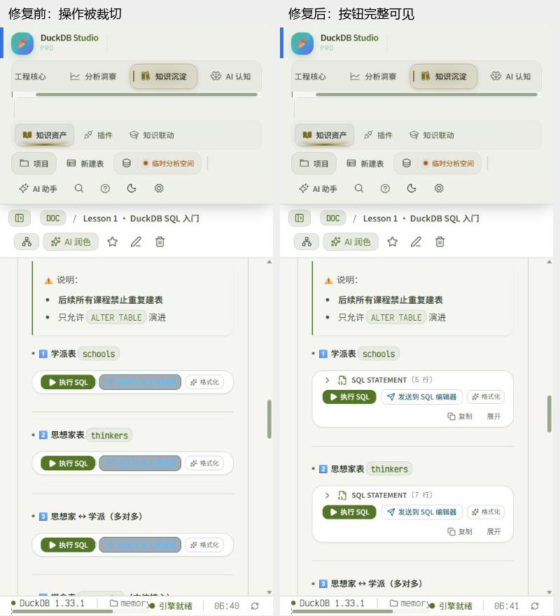
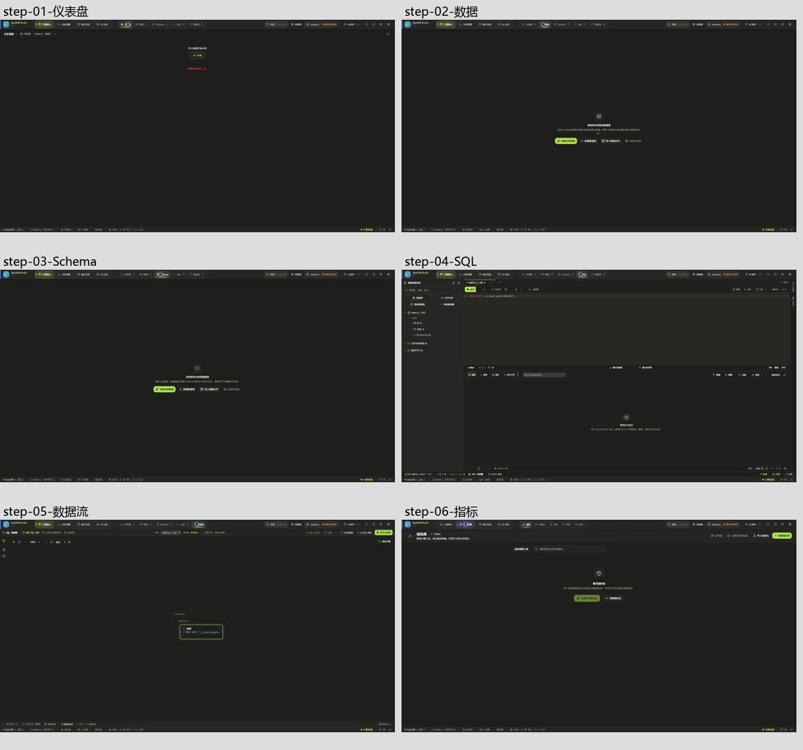
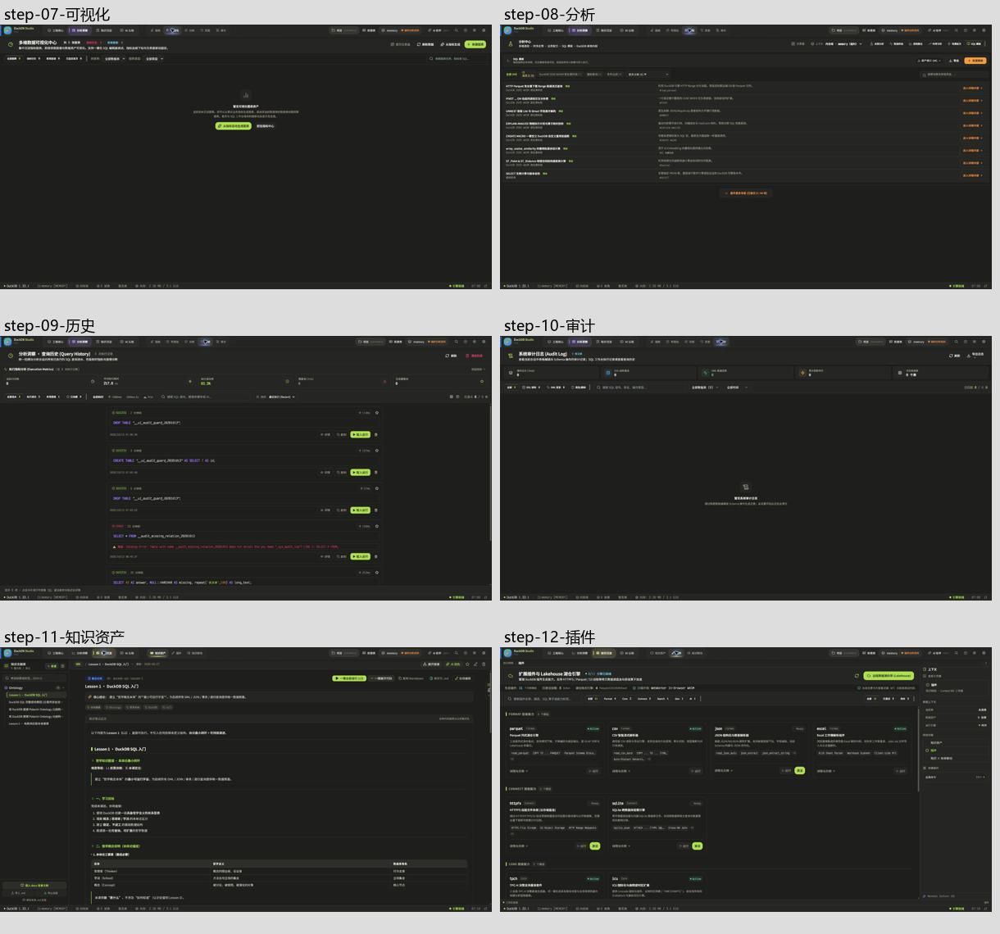
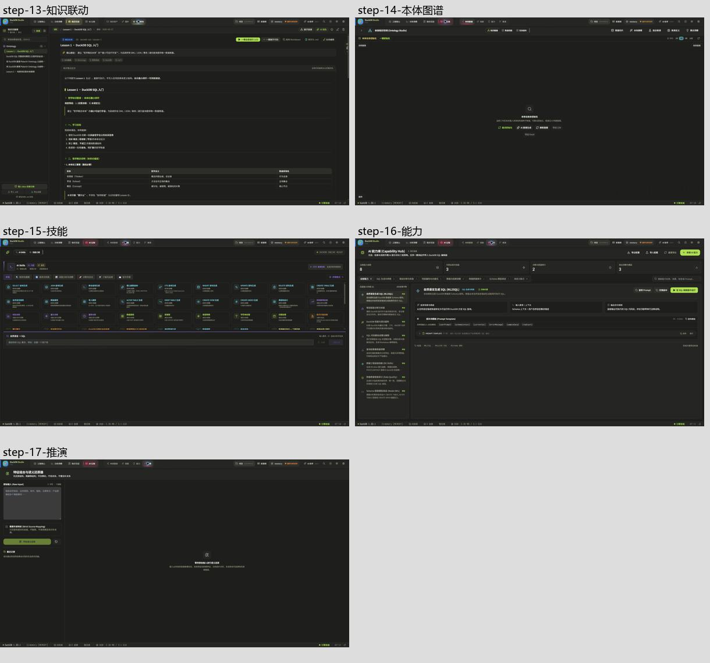

# 系统界面、功能与交互审查记录 — 2026-10-13

本次在当前工作区执行实际检查和最小修复。保留现有 Monokai 风格、导航结构、业务模块以及此前未提交的改动。没有重建界面、合并行为不同的组件或追加局部 CSS 覆盖。

**结论：已修复下述 6 类有证据的问题；不能据此宣布整个系统所有功能和状态组合均已验收通过。**

## 检查方式与边界

- 通过真实浏览器访问本地 Vite 服务，使用真实 DuckDB WASM 执行 SQL。内置浏览器加载失败后使用 Chrome 备用通道。
- 逐项访问 17 个入口；保存当前运行的 DOM 记录、截图及问题复现记录。
- 浅色、深色主题分别检查 1440×1000 和 390×844 的入口、当前状态和窗口边界；最终截图另采用浏览器默认桌面尺寸。矩阵记录只证明入口及记录中的状态，不代表全部子功能通过。
- 使用独立命名的 `__ui_audit_guard_20261013` 验证表进行建表、读回、筛选、结构与删除回归。验证后已清理，当前内存库再次为 0 张业务表。
- 早期快速循环采集出现截图落后于 DOM 的情况，相关截图已拒绝并移除；最终 `step-01` 至 `step-17` 独立采集并打开总览核对。保留的矩阵 TXT/JSON 是结构记录，不冒充已接受的逐状态视觉证据。
- 历史审查文件仅作为定位线索，没有作为本次通过证据。

## 已确认问题、根因与修复

| 编号 | 类型 | 实际问题与根因 | 最小修复 | 验证 |
|---|---|---|---|---|
| F1 | 共用组件 | 390px 窗口中 SQL 代码块工具栏固定高度且操作组不能换行。操作组超过代码块边界，“复制”“展开”被裁切。 | 共用代码块头部允许换行并随内容增长，操作组限制在可用宽度内。桌面单行高度仍为 32px。 | [修复前](code-toolbar-before-light-390.png)、[修复后浅色](code-toolbar-after-light-390.png)、[修复后深色](code-toolbar-after-dark-390.png)；展开、编辑与复制均实际执行。 |
| F2 | 共用组件主题 | 代码块发送操作采用独立 sky 深色背景及文字，浅色下可读性较差；行数、预览、修改状态也绕过现有语义颜色。 | 复用现有 cyan/comment/yellow 颜色及状态规则。没有新增颜色值或 CSS 覆盖。 | 两种主题截图及实际复制、发送 SQL 的反馈；发送内容与编辑内容一致。 |
| F3 | 共用执行逻辑 | 合法 `SELECT 'a;b--c/*d*/' AS preserved_text;` 在单块执行中报“未结束的字符串或标识符”。根因是正则删注释后按分号拆分，字符串被破坏；批量执行有同一实现。 | 两处都复用已有 `splitSqlScript`。批量解析失败计入该块错误，继续记录后续块。 | [错误复现](sql-string-parser-before.png)、[真实引擎修复结果](sql-string-parser-after-light-390.png)；新增字符串、dollar quote 和失败后继续执行测试。 |
| F4 | 通用执行语义 | 通用单块执行会隐式创建示例表，还会把 `CREATE TABLE` 改写成 `CREATE OR REPLACE TABLE`。前者使只读执行改变数据库目录，后者改变用户 SQL 的数据保留语义。 | 移除通用代码块中的隐式示例初始化和 CREATE 改写。教程专用批量执行的原有预置/幂等流程独立保留，未按外观相似合并业务。 | 修复后只读字符串查询没有生成示例表。重复创建独立验证表得到 already exists，[原记录 7 仍保留](create-existing-data-preserved.txt)；相关单元回归通过。 |
| F5 | 局部布局 | 分析中心操作容器额外嵌套，未约束宽度。390px 下末项标签位于容器外，键盘聚焦末项会横向移动整个内容区。 | 仅给既有容器增加 `min-w-0 max-w-full`；不改共用标签组件。 | [修复前](analysis-keyboard-end-light-390.png)、[浅色修复后](analysis-keyboard-end-after-light-390.png)、[深色修复后](analysis-keyboard-end-after-dark-390.png)。标签条宽约 350px，外层 scrollLeft=0，Home/End 能切换首末项。 |
| F6 | 全局状态 | SQL 删除已选表后目录与页脚为 0 张表，但数据页仍显示旧表及记录。表目录更新未撤销失效选择。 | 在全局 `setTables` 中核对选择；仅清理已消失的当前表及属于该表的数据集，保留独立查询与其他数据集。 | [修复前旧记录残留](deleted-table-stale-before.png)、[修复后空状态](deleted-table-stale-after.png)。真实重复建表→选择→删除→返回数据页回归；4 项新增状态测试及相关回归通过。 |

## 逐入口覆盖记录

“已检查”仅适用于本行列出的内容。所有入口都有两主题、两窗口尺寸的结构扫描记录；本表中未执行的功能不标为通过。

| 步骤 | 入口 | 当前健康与实际检查内容 | 最终截图 |
|---|---|---|---|
| 1 | 仪表盘 | 入口、无数据引导与刷新入口正常显示；未创建并遍历所有组件实例。 | [截图](step-01-仪表盘.png) |
| 2 | 数据 | 空库、真实表浏览、空筛选结果、键盘清除筛选恢复、分页禁用、删除表后返回均已验证；F6 已修复。 | [截图](step-02-数据.png) |
| 3 | Schema | 空库、真实字段类型、结构联动、画像总数/最小最大值与返回路径已验证；未执行全部字段变更。 | [截图](step-03-Schema.png) |
| 4 | SQL | 真实成功查询、未知表错误、Loading、运行/停止禁用切换、长文本、NULL、历史联动、发送代码、创建与删除验证表已检查。 | [截图](step-04-SQL.png) |
| 5 | 数据流 | 入口、当前查询生成逻辑节点及执行结果关联已检查；未遍历所有自由编排算子组合。 | [截图](step-05-数据流.png) |
| 6 | 指标 | 空库及有表时生成按钮状态、搜索与新建入口已检查；完整业务口径生命周期未覆盖。 | [截图](step-06-指标.png) |
| 7 | 可视化 | 入口、空图表、分类/表/类型筛选控件已检查；没有把全部图表类型和固定首页流程标为通过。 | [截图](step-07-可视化.png) |
| 8 | 分析 | 空表状态、真实表绑定、模板模式、首末标签键盘导航及 F5 回归已验证；所有配方计算未覆盖。 | [截图](step-08-分析.png) |
| 9 | 历史 | 查询成功/失败记录、详情抽屉、Escape 关闭与结果关联已验证。 | [截图](step-09-历史.png) |
| 10 | 审计 | 入口、空日志、分类/表/时间控件已检查。SQL 历史与表格/Schema 审计是不同业务范围，未合并。 | [截图](step-10-审计.png) |
| 11 | 知识资产 | 现有文档、长标题、代码展开/编辑/复制/发送/执行、结果与错误恢复已验证；F1–F4 已修复。 | [截图](step-11-知识资产.png) |
| 12 | 插件 | 状态、分类及 End 到 AI 末项后实际过滤已验证；未安装/联网加载所有扩展。 | [截图](step-12-插件.png) |
| 13 | 知识联动 | 文档与图谱面板当前渲染、切换入口及共享代码块覆盖；未完整重跑全部教程。 | [截图](step-13-知识联动.png) |
| 14 | 本体图谱 | 空数据/查询来源提示、数据切片与当前图谱入口已检查；没有验证所有映射、布局与大图算法。 | [截图](step-14-本体图谱.png) |
| 15 | 技能 | 列表、分类、空输入禁用与两主题窗口状态已检查；外部模型生成未执行。 | [截图](step-15-技能.png) |
| 16 | 能力 | 已有能力、筛选、模板和运行入口显示已检查；外部模型调用与配置导入导出全流程未覆盖。 | [截图](step-16-能力.png) |
| 17 | 推演 | 输入、严格映射选项、空输入禁用与等待状态已检查；模型推演输出未验证。 | [截图](step-17-推演.png) |

## 状态覆盖与证据限制

| 状态/场景 | 实际覆盖 | 限制 |
|---|---|---|
| Hover | 真实鼠标点击后控件 hover 外观、代码块按钮与导航的既有样式检查 | 未逐个控件停留并测量全部 hover 组合 |
| Focus | 分析/插件标签键盘首末项、表单初始焦点、详情 Escape 关闭 | 未运行屏幕阅读器和完整焦点顺序审计 |
| Active | 导航与标签选中状态实际切换 | 瞬时按压样式未逐控件捕获，不宣称全面通过 |
| Disabled | 查询执行中按钮、分页边界、空输入、新建表空名称 | 全部业务禁用条件组合未覆盖 |
| Loading | 引擎启动、查询、数据/元数据/结构加载、懒加载入口 | 人工断网与所有超时恢复未覆盖 |
| Empty | 空库、空资源、无匹配筛选结果、无图谱输入等 | 非每个业务对象的全部空态 |
| Error | 字符串错误复现、未知关系、重复建表、解析失败的批量报告 | 外部 API、远程文件、扩展下载失败未验证 |
| Success | SQL 返回值、NULL/长文本、复制内容、发送 SQL、画像与目录更新 | 外部模型成功结果未验证 |

截图只能支持可见状态。没有声称 WCAG 合规，也没有把入口正常等同于所有按钮、链接和业务全链路正常。

## 验证结果

- 最终相关回归：**13 个文件、96 项测试通过，退出码 0**。记录：`../../output/system-review-20261013-all-targeted-final.log`。
- 最终类型检查：**通过，退出码 0**。记录：`../../output/system-review-20261013-typecheck-final.log`。
- 最终生产构建：**通过，退出码 0**。保留现有体积告警，没有为此做无依据拆包。记录：`../../output/system-review-20261013-build-final.log`。
- 本轮变更文件的空白检查通过。
- 全量测试早期尝试长时间未完成，最后被中止；当时输出有 Canvas 环境提示，**未查明其是否为停滞根因，不认定全量测试通过或失败**。

## 修改范围

生产代码仅修改 4 处：`CodeHighlightBlock.tsx`、`ontologySynthesisEngine.ts`、`AnalysisHubPanel.tsx`、`useAppStore.ts`。另修改/新增 3 份相关测试，以及本报告和证据文件。此前工作区修改未回退，未创建提交或推送。

复用现有分句器、语义颜色及布局工具类。保留正常的横向标签滚动、Schema 表格滚动、代码编辑区滚动、审计范围差异、教程专用批量行为以及各模块本来的视觉密度。

下一轮全面验收仍需覆盖外部 AI 与远程数据源、全部图表/配方/图谱算子，以及未执行的业务和状态组合；这些范围目前未标为通过。
