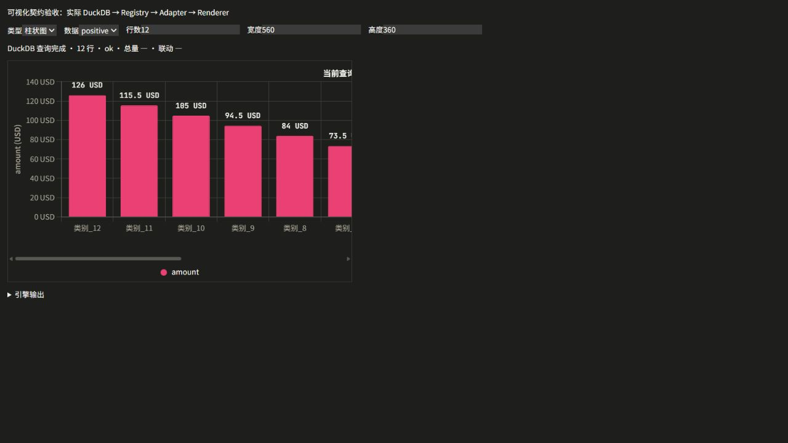
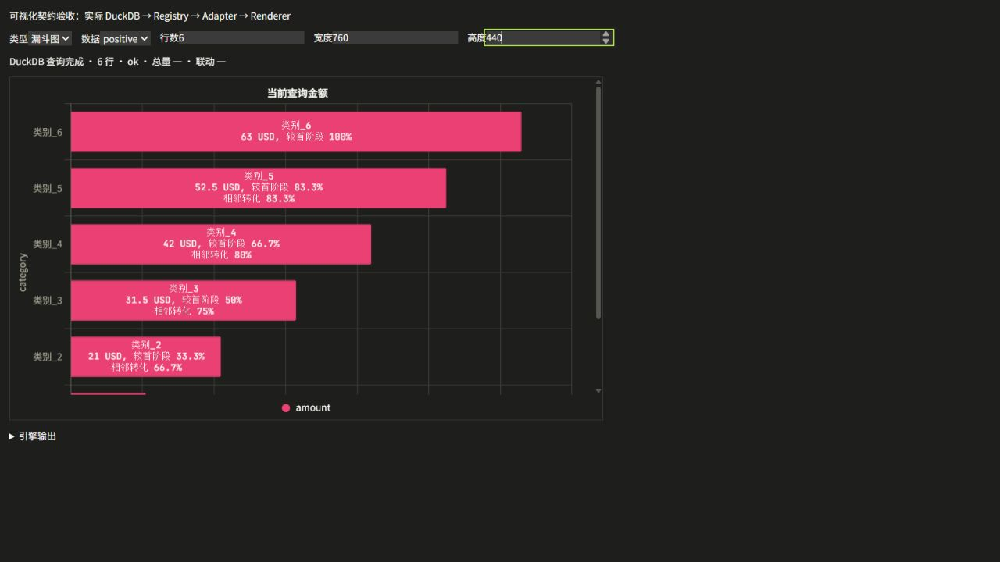

# 全项目可视化扫描与修复记录

日期：2026-10-08。项目：duckdb-editor。保留现有 Chart.js、D3、React Flow、Pixi、Mermaid、SVG 技术栈。工作区原有大量修改与删除，本次没有重置或提交这些改动。

## 入口与数据链路

统计图入口包括 ChartBuilder、DashboardWidget、ChartDashboard、AnalysisHub、Workbench ResultSection 和 AnalysisTimeSeries。统计主链统一为 AnalysisSpec / 数据集查询 → Chart Registry → ChartSpec → chartJsAdapter → ChartRenderer。配置面板复用 WidgetChartConfigPanel。SQL 查询通过现有 DuckDB 服务运行；看板筛选继续走现有 Workbench 编译及执行层。

实际统计类型为柱状、折线、面积、饼、圆环、散点、表格、透视表、指标卡、计数器、漏斗、瀑布、直方图及组合图。关系图入口包括 OntologyPanel 中的 D3GraphView / OntologyCanvas、SchemaGraphView、ERDiagram、CausalGraph、MermaidChart、DataFlow 与拓扑组件；关系图继续使用自身的图结构模型，不能把拓扑节点误当成数值 Series。

## 收敛后的公共规则

| 共性问题 | 统一修复位置与行为 |
| --- | --- |
| 空值、布尔、对象、NaN、Infinity 被当作数值 | chartFormat.chartNumber 严格识别有限数值，Formatter 显示 — |
| Tooltip、轴、标签、表格单位与精度不一致 | chartFormat 的 ValueFormatSpec；所有统计渲染使用同一 Formatter |
| 时间字符串排序、重复维度丢失、缺失值静默填零 | chartDisplay：真实时间排序、保留记录、明确 break / zero / forward_fill |
| 堆叠、比例、右轴计算分散 | chartRegistry 与 chartDisplay：当前上下文计算，拒绝负值百分比堆叠和混合量纲同轴 |
| 柱体标签无几何避让、漏斗长标签截断 | chartUtils 测量实际文本和柱体；funnel 使用三行标签和独立行高，内外自动切换 |
| 饼图小份额隐藏、外标签只显示比例 | chartPlugins 消费预先计算的数值与比例；外置引导线；小份额保留 |
| 大数据画布无限扩张 | chartWindow 分页既有分析结果，chartSpace / chartPixelRatio 限制实际画布尺寸与像素预算；不改变总量或累计值 |
| 散点无法识别记录、大小映射异常 | Registry 保留原始维度与记录、颜色和大小域；统一趋势与 IQR 异常点；框选生成多值筛选 |
| 直方图固定分箱与错误频率 | chartDisplay 当前数据自动分箱，允许 Bin 数；Tooltip 区间、频次、比例；非法预分箱状态明确 |
| 漏斗与瀑布比例/累计语义错误 | 首阶段占比和相邻转化率；瀑布区分总量节点、变化量和累计量，缺失变化不得静默归零 |
| 表格和透视重复实现、截断和错误 AVG | 看板及 SQL 结果改统一 Renderer；分页、固定列、排序筛选、汇总与单元格联动；Pivot 使用 sum/count 累积，文本 count 统计非 NULL，筛选后重新汇总 |
| 更新失败或请求逆序恢复旧图 | Dashboard 清空旧结果；useVisualizationRequest 统一 Mermaid / ER / Schema 异步请求有效性；身份变更清空图例及选择状态 |
| KPI 虚构涨跌或无比较基准 | 合法非零基准才显示变化率，显示比较基准；遥测统一当前时段与前一等长时段 |
| 遥测伪造历史和数据量 | telemetryCharts 仅使用真实时间戳、成功导入行数、实际内存采样；没有内存历史时明确单点采样 |

## 自动验证

- 最终相关回归：36 个文件、267 项全部通过，见 visualization-verified-tests.txt，涵盖 Registry、计算、Formatter、Adapter、Renderer、Workbench 编译与执行、SQL 结果、看板异步状态、透视交互和 Mermaid 请求逆序。
- 关系图回归：visualization-graph-tests.txt，20 个文件 / 642 项通过。该结果来自本次扫描期间的关系图测试，不能视为每个图形页面的像素验收。
- 类型检查：通过，visualization-typecheck.txt。
- 生产构建：visualization-build.txt，完成；构建仍提示已有较大的资源分块。
- 扩展首页测试：visualization-final-tests.txt，45 个文件中 44 个通过，251 / 252 项通过。唯一失败是 MissionControlBidirectionalFlow 的旧“尚无数据表”文案断言；其 mock 仍指向旧 homeDefaultVisualizations，而当前首页使用 dynamicHome。未为该旧测试改变产品行为。全项目测试不能因此宣称全绿。
- jsdom 的 canvas getContext 警告意味着这些测试不验证像素布局；实际画布布局另在浏览器验证。

## 浏览器验证

验收页面：test/visualization-contract.html。页面通过实际 DuckDB SQL 查询生成边界输入，再走实际 Registry / Adapter / Renderer；没有给生产页面注入静态 Demo 或替换真实数据链路。

已检视 13 个注册统计图型的基本渲染及正值、负值、零、NULL、空数据状态；尺寸包含 760×440、560×360、280×240。10,000 行柱状图使用窗口分页，10,000 扇区保留全部数据、总量和分母，仅分页标签及图例，避免创建无限尺寸画布。小容器允许内部滚动以保留可读标签。

运行证据：

## 验收边界

本次完成了全入口代码扫描与上述公共层修复，并对实际渲染器和相关数据链路回归。没有逐个真实数据库、所有生产页面、全部浏览器缩放倍率及每种任意字段组合做穷举像素验收。散点框选的数据选择和参数化多值联动有自动测试，但当前浏览器控制接口未完成真实指针拖动回归。关系图有源代码及自动回归证据，未对所有关系图页面逐一录制实际交互。因此这份报告不声称用户列出的全量验收矩阵已全部完成，也不把旧首页流程测试失败隐藏为通过。

后续新增图型必须在 Registry 生成 ChartSpec；计算不能放回组件，单位不能在 Tooltip 与 Label 各自拼接；分页不得重算比例分母；异步刷新不得恢复旧结果。边界回归必须覆盖 NULL / 非有限值、正负值、时间顺序、数据源切换和当前筛选上下文。
